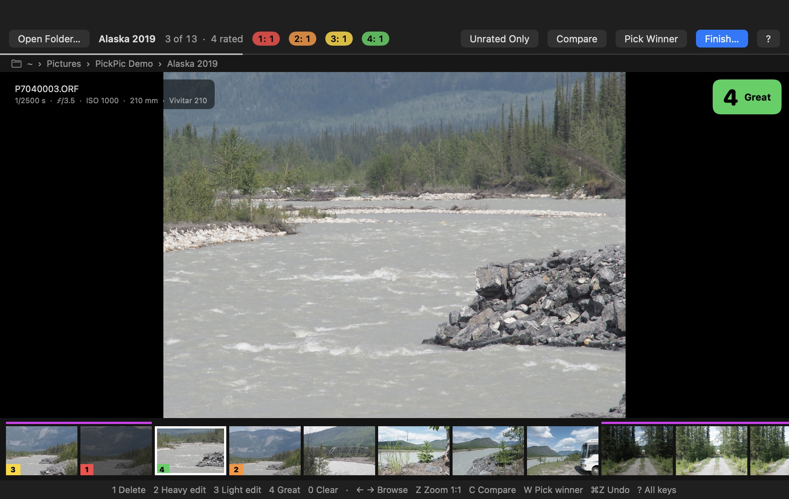

# PickPic (beta)

Fast photo culling for Mac. Open a folder, arrow through it, and press one key per photo. PickPic never edits a photo, and there is no library to import into.



## Download

Get the latest zip from the [Releases](../../releases) page. It contains PickPic.app (Apple silicon + Intel) and the Quickstart PDF.

**Needs:** macOS 14 or later. Tested on Apple silicon with macOS 27. Intel testers wanted.

**First launch:** this beta is not notarized by Apple, so macOS blocks it the first time. Double-click PickPic, dismiss the warning, then go to System Settings > Privacy & Security, scroll down and click **Open Anyway**. You only do this once.

> This is beta software that tags, moves and trashes files. Try it on a **copy** of a photo folder first.

## What it does

- **Four ratings, one keypress each.** 1 Delete, 2 Heavy edit, 3 Light edit, 4 Great. Saved as colored Finder tags. No database.
- **RAW, JPEG, HEIC** and anything else macOS can open. RAW + JPEG pairs (and .xmp/.aae sidecars) are handled as one photo.
- **1:1 zoom** for checking focus.
- **Side-by-side compare** with linked zoom and pan.
- **Burst detection** and a **Pick a winner** mode for choosing the best frame in a burst.
- **Finish** moves keepers into a "To Edit" folder and sends rejects to the Trash. Both are optional, and you choose which ratings move.

Full details and every keyboard shortcut are in the [Quickstart guide](PickPic%20Quickstart.pdf).

## Keys

| Key | Action | Key | Action |
|---|---|---|---|
| ← → | Previous / next | Z | 1:1 zoom |
| 1 2 3 4 | Rate | C | Compare side by side |
| 0 | Clear rating | W | Pick a winner |
| U | Next unrated | F | Unrated only |
| ⌘Z | Undo | I | Shot details |
| ⌘↩ | Finish | H | Hide the bars |
| ⌘O | Open a folder | ? | Show all keys |

## Feedback

Bug reports and feature requests are what this beta is for. Open an [issue](../../issues) and include:

- Your Mac model and macOS version
- Your camera and file format (for example, Olympus .ORF or Sony .ARW)
- What you did, what you expected, and what happened instead

## Building from source

Requires the Xcode command line tools (`xcode-select --install`).

```bash
./build.sh      # builds PickPic.app in this folder
./package.sh    # builds a universal (Apple silicon + Intel) zip for sharing
```

PickPic is deliberately small: a quick cull and sort, not a photo editor. Windows and Linux ports are welcome if you know those platforms' file management.
